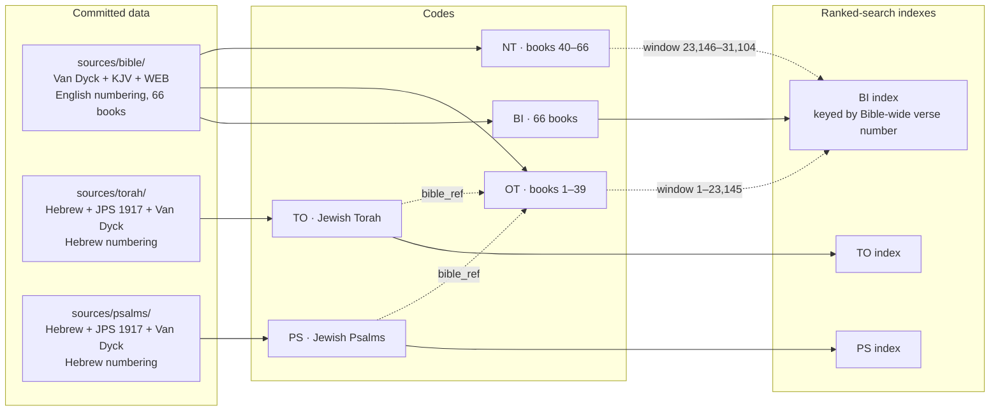

# Plan — the Bible (`BI`, `OT`, `NT`), the Torah (`TO`) and the Psalms (`PS`)

**Status:** phases 0–7 implemented and released as **4.0.0** (2026-10-22).
Phase 8 is optional and not started. Decision 8 is still open (§10).
Where the build departed from this plan, the next section says so; the rest
of the document is the design as planned.

**Decided:** `TO` is the **Jewish Torah** and `PS` the **Jewish Psalms**, each
kept separate from its counterpart inside the Bible (§2).

**Constraint:** extend, never break. Every query that works on `main` today
keeps its meaning and its output, byte for byte. Every query that fails today
still fails, with the same error code at the same position.

---

## As built — where the implementation departs from the plan

- **Error preservation lives in `Context`, not the parser.** `qql::parse`
  alone now accepts a name after any code — `Q:GEN` parses — since it cannot
  know which sources take names. Executing such a query fails exactly as
  before: `Context` refuses the name with the old parser's error. When a later
  syntax error follows the name, `parse_tracked` reports the names it saw and
  the earlier one wins, as it did in the old parser. Checked against the
  pre-path parser on 292,284 generated queries: no difference in code or
  byte position. Only `qql --parse` shows the change.
- **`IndexKeys::Flat` carries no offset.** Where `NT` starts in the Bible-wide
  numbering is read from the data (`Source::flat_offset`), not hard-coded.
- **`TO` also carries the KJV and WEB** (`en_kjv`, `en_web`), re-cut like the
  Arabic, to match `PS` after decision 7.
- **The Ten Commandments** (Exodus 20, Deuteronomy 5): JPS numbers them by the
  lower accents, joining commandments 6–9 into one Hebrew verse. eBible's
  Hebrew keeps them apart, as English Bibles do, so `build-torah.py` ignores
  JPS's markers in those two chapters and keeps the English numbers.
- **Numbers 26 keeps its verse count** in both numberings; only half its
  first verse moves to 25:19. The ten places therefore touch 19 chapters, not
  20.
- **The field is `bible_ref` everywhere** (the plan also called it
  `ot_ref`). It names the first English verse a Hebrew verse belongs to, or a
  range such as `OT:PSA:13:5-6`.
- **One shared USFM reader**, `scripts/usfm.py`, serves the Psalms, Bible
  and Torah builds. It reproduces eBible's plain text for Van Dyck and the
  KJV on all 66 books. The WEB differs only where its plain-text export leaks
  speaker labels and Psalm 119 headings into verses, or carries older wording.
- **The Bible carries its original languages** — added after phase 7. That
  is `he` (the Masoretic Hebrew, with its Aramaic) on Old Testament verses and
  `grc` (the Greek Textus Receptus) on New Testament ones. The Hebrew reaches
  the English verses through `scripts/hebrew.py`, the JPS-derived map now
  shared by all three builds. It adds one more explicit rule: Nehemiah 7:68
  is not in the Masoretic text.
- **Measured sizes:**
  - Bible data: 26 MB with the originals, indexes 17 MB + 5.2 MB.
  - Torah data: 6 MB, indexes 3.2 MB + 1.2 MB.
  - Psalms data: 2 MB.

---

## 1. Summary

| Code | What | Edition | Example |
| --- | --- | --- | --- |
| `BI` | The whole Bible — 66 books | Christian: Van Dyck Arabic, KJV, WEB | `BI:OT:GEN:1:1` · `BI:NT:JHN:3:16` |
| `OT` | Old Testament — 39 books | Christian, as above | `OT:GEN:1:1` — same verse as `BI:OT:GEN:1:1` |
| `NT` | New Testament — 27 books | Christian, as above | `NT:JHN:3:16` |
| `TO` | Torah (Tawrat) — 5 books | **Jewish**: Hebrew, JPS 1917, Van Dyck Arabic re-numbered | `TO:GEN:1:1` |
| `PS` | Psalms (Zabur) — 1 book | **Jewish**: Hebrew, JPS 1917, Van Dyck Arabic re-numbered | `PS:23:1` |

The Torah and the Psalms therefore exist **twice**, on purpose: once inside
the Bible (`OT:GEN`…`OT:DEU`, `OT:PSA`) in the Christian edition with English
verse numbers, and once on their own (`TO`, `PS`) in the Jewish edition with
Hebrew verse numbers. Every `TO` and `PS` record carries a `bible_ref` that
is a working query for the same passage in the Bible, so the two numberings
can never be confused (§6).

The Old and New Testaments are **collections of books**, so the book still
follows the code: `OT:GEN:1:1`. That third level is the one thing the grammar
lacks today. `PS` is a single book and needs no grammar change at all.

---

## 2. Jewish edition against Christian edition

### 2.1 The Torah

The same five books with the same Hebrew text underneath, in a different
edition:

| | In the Bible (`OT:GEN`…`OT:DEU`) | Jewish Torah (`TO`) |
| --- | --- | --- |
| Books | Genesis, Exodus, Leviticus, Numbers, Deuteronomy | The same five: Bereshit, Shemot, Vayikra, Bamidbar, Devarim |
| Text | Translations of the Hebrew Masoretic Text | The Masoretic Text itself |
| English | KJV (Christian) | JPS 1917 (Jewish, public domain) |
| Verse numbers | English: 5,852 verses | Hebrew: 5,853 verses |
| Divisions | Chapters (a 13th-century Christian addition) | 54 weekly readings (parashot); chapters adopted later |

- **No canon adds anything to the Torah.** Catholic and Orthodox Bibles add
  books elsewhere in the Old Testament.
- **Wording differs where interpretation enters.** Genesis 49:10 is "until
  Shiloh come" in the KJV and "as long as men come to Shiloh" in JPS 1917.
- **Greek-based translations differ again.** Older Catholic and Orthodox
  translations follow the Septuagint, which departs from the Hebrew even here
  (the patriarchs' ages in Genesis 5 and 11). The KJV and Van Dyck translate
  the Hebrew, so this does not affect QQL.
- **Verse numbers differ in ten places.** At each, a verse moves across a
  chapter boundary:

  | Hebrew (`TO`) | English (`OT`, KJV, Van Dyck) |
  | --- | --- |
  | Gen 32:1; 32:2–33 | Gen 31:55; 32:1–32 |
  | Exo 7:26–29; 8:1–28 | Exo 8:1–4; 8:5–32 |
  | Exo 21:37; 22:1–30 | Exo 22:1; 22:2–31 |
  | Lev 5:20–26; 6:1–23 | Lev 6:1–7; 6:8–30 |
  | Num 17:1–15; 17:16–28 | Num 16:36–50; 17:1–13 |
  | Num 25:19 + 26:1 | Num 26:1 — **one English verse is two Hebrew verses** |
  | Num 30:1; 30:2–17 | Num 29:40; 30:1–16 |
  | Deu 13:1; 13:2–19 | Deu 12:32; 13:1–18 |
  | Deu 23:1; 23:2–26 | Deu 22:30; 23:1–25 |
  | Deu 28:69; 29:1–28 | Deu 29:1; 29:2–29 |

  Checked against eBible.org's Hebrew text: Genesis 32 has 33 verses and
  opens with Laban rising early. Exodus 21 and Numbers 17, 25 and 30 have 37,
  28, 19 and 17 verses, against the English 36, 13, 18 and 16. The rest come
  from a published comparison table, and the build verifies all ten against
  the data. The Van Dyck Arabic numbers exactly as the KJV does at all ten.

### 2.2 The Psalms — the same question, a bigger difference

The psalm *numbers* agree: Jewish and Protestant editions both follow the
Hebrew, and only Greek-based Catholic and Orthodox editions are off by one for
most psalms. The *verse* numbers differ far more than in the Torah:

- **The Hebrew counts a psalm's title as a verse.** Psalm 3 has 9 verses in
  Hebrew and 8 in English. Its Hebrew verse 1 is only the title, "A Psalm of
  David, when he fled from Absalom his son". The prayer begins at verse 2.
- Some titles take **two** Hebrew verses (Psalm 51 has 21 verses against
  English 19).
- In total, Hebrew has **2,527 verses** and English **2,461**, so 66 verses
  differ by one or two. Where the title shares a verse with the first line, as
  in Psalm 23, the numbers agree.

**Built (phase 1).** `PS` is the Jewish edition. The Christian-edition `PS`
first built on `add-psalms` was never merged or released, so the switch broke
nobody. Each verse carries:

- the Hebrew as `he`;
- JPS 1917 as `en`;
- Van Dyck as `ar`;
- the KJV and WEB as `en_kjv` and `en_web`.

The translations are re-cut to the Hebrew verses, and every record's
`english_verses` gives the English number. `PS:3:1` returns the title alone,
while `PS:23:1` still returns "The LORD is my shepherd".

### 2.3 Arabic for the Jewish editions

The classic Jewish Arabic translation is Saadia Gaon's tafsir (10th century).
It survives in **Hebrew letters** (Judeo-Arabic), and the public-domain
Derenbourg edition (1893) exists only as a scan. Using it would mean
transcription and transliteration — a project of its own.

Recommendation: give `TO` and `PS` the Van Dyck Arabic, re-numbered to the
Hebrew verses and labelled as Van Dyck. Saadia can replace it later if a text
becomes usable.

Muslims hold that the Tawrat was revealed to Musa and the Zabur to Dawud. QQL
carries the texts as the Jewish and Christian communities transmit them today,
labelled by edition, and makes no claim about how they relate to the original
revelation.

---

## 3. Address syntax

### Grammar

One addition: an optional **path** of names between the code and the body.
Everything after the path is today's grammar, unchanged, applied inside the
book.

```text
reference := (source ':')? path (':' body)?
           | (source ':')? body                 // unchanged
path      := segment (':' segment)*             // GEN · OT:GEN
segment   := ident | integer ident              // GEN · JHN · 1SA (no space inside)
```

- A segment can appear **only directly after a stated code**. That is exactly
  where an identifier is a syntax error today.
- `1SA`, `2KI`, `1JN` — book names that start with a digit — are read by the
  parser as an integer immediately followed by an identifier, and only in the
  segment slot. **The lexer does not change.**
- The parser still knows no book names: `Q:GEN:1:1` parses and is rejected
  later, as `Q:500:999` is today.
- `Reference` gains `path: Vec<Segment>`, where each segment has a name
  (uppercased, like codes) and a byte position. It is empty for every query
  that parses today, and it is skipped when serialized, so `qql --parse`
  output is unchanged.

### Examples

| Query | Meaning |
| --- | --- |
| `OT:GEN` · `OT:GEN:1` · `OT:GEN:1:1-5` | a book, a chapter, verses |
| `OT:GEN:1:1,2:3` | Genesis 1:1 and 2:3 — groups work as in `q:1:2,2:3` |
| `BI:OT:GEN:1:1` | the same verse as `OT:GEN:1:1` |
| `BI:GEN:1:1` | the same, testament omitted (decision 3) |
| `NT:1JN:4:8` | 1 John 4:8 |
| `TO:GEN:32:1` | Jewish Torah, Hebrew numbering — the Bible's `OT:GEN:31:55` |
| `TO:BERESHIT:1:1` | Hebrew book names work in `TO` |
| `PS:3:1` | Jewish Psalms: Psalm 3's title |
| `OT:PSA:3:1` | the Bible's Psalm 3:1 — title plus first line |
| `OT:GEN::5` · `OT::100` · `TO::1` | book-wide numbering, as `Q::N` |
| `BI:OT` | the whole Old Testament |
| `NT:"love"` · `BI:NT:JHN:?"love"~5` | exact search; ranked search in John |
| `OT:GEN:1:1;3:1` | the path carries forward with the source: Genesis 3:1 |
| `TO:GEN:1:1;OT:GEN:1:1;Q:2:255` | the editions and sources mix freely |

**Book names** are case-insensitive and owned by the sources:

- USFM codes: `GEN`, `1SA`, `MRK`, `JHN`, `1JN`.
- eBible's variants: `MAR`, `JOH`, `SOL`, `EZE`, `JOE`, `NAH`, `PHI`, `JAM`, `1JO`.
- Full English names without spaces: `GENESIS`, `1SAMUEL`, `SONGOFSOLOMON`.
- In `TO`, the Hebrew names: `BERESHIT`, `SHEMOT`, `VAYIKRA`, `BAMIDBAR`, `DEVARIM`.

The grammar is ASCII, so Arabic names cannot be typed.

**One trap to document.** In `OT:GEN:1:1;EXO:3:14`, the `EXO` after `;` is
read as a *source code*. It must be written `OT:EXO:3:14`; a phase-8 error
hint makes the mistake explain itself.

---

## 4. Compatibility — what does not change

1. **Valid queries.** Paths exist only where today's grammar fails, so every
   currently valid query parses to the same AST with an empty `path`, and its
   JSON is unchanged.
2. **Invalid queries keep their exact error.** A path on a source without
   books — `Q`, every hadith code, `HM`, `PS`, user-defined JSON sources — or
   on an unknown code is rejected in a **pre-pass**. The pre-pass runs over the
   whole query before anything resolves and reports what the parser reports
   today:
   - `Q:A` → `QQL_EXPECTED_NUMBER` at byte 2, already pinned in
     `tests/parser.rs` and left untouched.
   - `Q:1SA` → `QQL_INVALID_CHARACTER` at byte 3.
   - `XYZ:A` → `QQL_EXPECTED_NUMBER` at byte 4, ahead of `QQL_UNKNOWN_SOURCE`.

   New parser tests pin each of these, including an overflowing digit run.
3. **The lexer, the C ABI, `include/qql.h`, the Dart binding and the wire
   format** are untouched. The new record shapes come only from the new codes.
4. **`Source` gains only default methods** — `has_books()`, `flat_scope()`,
   `index()`. Existing sources and users' own `impl Source` compile and behave
   as before.
5. **No existing index is rebuilt.** The 55 MB of current indexes stay as
   they are.
6. **`PS` is not on `main`.** Its edition can still be chosen freely (§2.2).
7. **The one Rust-API break.** `Reference` gains a public field, so code that
   builds a `Reference` by struct literal adds `path: Vec::new()`. That is
   eight places inside the crate, plus any outside crate doing the same.
   Custom sources only *read* `Reference` and are unaffected. Decision 6
   covers the version number.

---

## 5. Data, editions and indexes



### Texts — all public domain, from eBible.org

| Field | `BI` / `OT` / `NT` | `TO` and `PS` |
| --- | --- | --- |
| `he` | — | Hebrew Masoretic Text (`hbo`), whose numbering is the authority |
| `ar` | Smith & Van Dyck (`arb-vd`) | Van Dyck, re-numbered to the Hebrew verses |
| `en` | KJV (`eng-kjv2006`) | JPS 1917 (`engjps`) |
| `en_web` | World English Bible (`eng-web`) | — |

### Data layout

```text
sources/bible/books.json               66 books: codes, aliases, names (en, ar),
                                       testament, verse count of every chapter
sources/bible/{BOOK}/{chapter}.json    { verse, ar, kjv, web }
sources/torah/{BOOK}/{chapter}.json    { verse, he, ar, en, bible_ref }
sources/psalms/{psalm}.json            { verse, he, ar, en, kjv, web, english }  — built
sources/{bible,torah,psalms}/ATTRIBUTION.md
```

Files are split per chapter, as the hadith data is, so `NT:JHN:3:16` reads
about 10 KB. The Bible's 1,189-chapter table lives in `books.json`, not in
Rust; a test walks it against the files, as the Quran and Psalms tests do.

### Re-numbering the Jewish editions — every split is driven by a marker

The Hebrew text defines the verses. The two translations arrive in English
numbering and are cut to fit:

- **JPS 1917** — eBible's export carries the Hebrew verse numbers inside the
  text, as "(3-1)" … "(3-9)" in Psalm 3. The build cuts at those markers, so
  each Hebrew verse gets exactly its own words, including the Torah's split
  verse, Numbers 25:19 / 26:1.
- **Van Dyck** — the USFM source keeps a psalm's title apart from verse 1. It
  is rendered as a heading and only merged into verse 1 in the flat export
  `PS` used so far. The title therefore fills the Hebrew title verse and the
  rest fills the next.
  - Where the Hebrew splits a title across two verses (Psalm 51 and a few
    others), the Arabic title goes on the first and the second carries `""`.
  - The Torah's one mid-verse split, Numbers 26:1, gets a single explicit cut
    rule, which is asserted.

`build-torah.py` and `build-psalms.py` refuse to write unless:

- Every chapter has the Hebrew text's verse count.
- Every Torah shift in §2.1 is found where the table says.
- The anchor words fall in the same verses across all three languages:
  *Selah*/`סלה`/`سلاه`, *David*/`דוד`/`داود`, *Moses*/`משה`/`موسى`. The same
  check proved the Psalms pairing: 71/71 aligned, 1/141 shifted by one.
- Every empty field is on an explicit allowlist.

### Where the three Bible texts disagree (`BI` data)

Measured on the exports already downloaded:

| Where | KJV | Van Dyck | WEB | Plan |
| --- | --- | --- | --- | --- |
| 1 Tim 6:21–22 | 6:21 ends "Grace be with thee" | splits that off as 6:22 | as KJV | carry 6:22 with `ar` only |
| 3 John 1:14–15 | 14 verses | splits off 1:15 | as KJV | carry 1:15 with `ar` only |
| Romans' doxology | 16:25–27 | 16:25–27 | at 14:24–26 | move WEB's to 16:25–27 — the same words |
| Luke 17:36, Acts 8:37, 15:34, 24:7 | present | present | omitted | `en_web` is `""` |
| 15 deuterocanonical books | — | — | present | not carried; the 66-book canon matches KJV and Van Dyck |

An untranslated field is `""`, never a missing key, as `DA` and `MA` already
do. That gives `BI` 31,104 verses, `OT` 23,145 and `NT` 7,959.
`scripts/build-bible.py` reuses `build-psalms.py`'s USFM-to-text converter
(proven against eBible's plain-text exports: identical for Van Dyck and the
KJV) and its anchor checks.

---

## 6. Records

```json
{ "source": "NT", "collection": "New Testament", "testament": "NT",
  "book": "JHN", "book_name_en": "John", "book_name_ar": "يوحنا",
  "chapter": 3, "verse": 16,
  "ar": "…Van Dyck…", "en": "…KJV…", "en_web": "…WEB…" }

{ "source": "TO", "collection": "Torah (Tawrat)",
  "book": "GEN", "book_name_en": "Genesis", "book_name_he": "Bereshit",
  "chapter": 32, "verse": 1,
  "he": "…", "ar": "…Van Dyck…", "en": "…JPS 1917…",
  "bible_ref": "OT:GEN:31:55" }
```

- `source` is the code queried, so `OT:GEN:1:1` and `BI:OT:GEN:1:1` differ
  only there.
- `bible_ref` is on every `TO` and `PS` record and is itself a valid query.
  Where a Hebrew verse is only part of an English one (a psalm title, Numbers
  25:19), it points at the English verse containing it.
- The flat forms (`OT::100`) add `number` and `"numbering": "book"`, as `Q::N`
  does.

---

## 7. Search

- **Exact (`"…"`)** needs no engine change. The scope resolves as an ordinary
  reference; unscoped searches run each code's book-wide axis through
  `total()`.
- **Ranked (`?"…"`, `*"…"`) on the Bible needs one structural change.** Index
  keys are `(primary, number)` with one primary each, and Bible scopes cross
  books. Yet every Bible scope — testament, book, chapter, verse range — is
  **one contiguous run of the Bible-wide verse number**. So:
  - `BI` is indexed once by that number. Primary 0 means "the book-wide axis",
    and a hit resolves back through `BI::N`.
  - `OT` and `NT` are **windows** onto it, an offset and a length, so
    `OT:?"x"` and `BI:OT:?"x"` rank identically. Separate indexes, each with
    its own IDF statistics, could not promise that.
  - `flat_scope()` turns any scope into that one range. `fulltext::build` and
    `build-vectors.py` learn to index a source by its flat axis.
  - That is about 24 MB for one set, against about 52 MB for separate
    `BI`/`OT`/`NT` indexes, and every rebuild stays in git history.
- **`TO`** has its own small flat-keyed index. **`PS`** keeps today's
  `(psalm, verse)` keys, rebuilt for the Hebrew numbering.
- **Searched fields are `ar` and `en`.** `he` and `en_web` are returned but
  not searched. Hebrew search would need a `Record` field and Hebrew folding
  (vowel points, cantillation), the way `emlaei` was added (phase 8).
- Without the feature or an index, ranked search returns `QQL_UNSUPPORTED`,
  never a silent substring fallback.

---

## 8. Phases

Each phase ships alone and leaves the full suite green in all four feature
combinations.

| # | Phase | Observable change |
| --- | --- | --- |
| 0 | **Prerequisites.** Push `main`. **Done.** | none |
| 1 | **Jewish `PS`.** Hebrew, JPS 1917, Van Dyck, KJV and WEB in Hebrew numbering, with the marker-driven split and the gates in §5. **Done** on `add-psalms`. | `PS` ships |
| 2 | **Grammar.** Path segments, digit-led names in the segment slot, the error-preserving pre-pass. Nothing uses paths yet. **Done.** | none |
| 3 | **Bible data.** `build-bible.py` (absorbing `add-psalms`' pairing work), `sources/bible/`, every gate in §5. **Done.** | none |
| 4 | **`BI` `OT` `NT` resolvers.** The book table, every address form, exact search, book-wide numbering. `PS` gains `bible_ref`. **Done.** | the new codes |
| 5 | **Ranked Bible search.** Flat-keyed index, windows, the `BI` index set. **Done.** | `?` and `*` on the Bible |
| 6 | **Jewish `TO`.** `build-torah.py`, the resolver, its index, `bible_ref`. **Done.** | `TO` |
| 7 | **Docs and release.** README, CHANGELOG, CLAUDE.md, Dart README, `package.sh` bundle and smoke lines, the version. **Done** — released as 4.0.0. | none |
| 8 | **Optional.** Comma groups that switch book (`OT:GEN:1:1,EXO:3:14`); an unknown-source hint ("EXO is a book — write OT:EXO:3:14"); searchable Hebrew; an Injil view (the four Gospels); aliases `BIBLE`, `TORAH`, `TAWRAT`. | as chosen |

Building them needs new downloads from eBible.org, which I will list with
sizes and ask about before fetching: `hbo`, `engjps`, and `arb-vd` in USFM.

---

## 9. Tests

- **Parser:** every path form; `1SA`, `2KI`, `1JN`; the path carrying over
  `;`; every existing parser test unchanged. Pre-pass equivalence: `Q:A`,
  `Q:1SA`, `XYZ:A` and an overflowing digit run all fail exactly as today.
  The fuzz target keeps running.
- **Bible:**
  - Every code and form; `BI:OT:x` ≡ `OT:x`.
  - Errors: `BI:OT:JHN` (wrong testament), `TO:JHN`, an unknown book, chapter
    or verse out of range, and a huge range that must not allocate.
  - A walk of all 1,189 chapters against `books.json`; book-wide numbering at
    its edges.
  - `BI:NT:3JN:1:15` has `ar` and an empty `en`; `BI:NT:ROM:16:25` has WEB's
    doxology; `NT:LUK:17:36` has an empty `en_web`.
- **Jewish editions:**
  - `PS:3` has 9 verses and `PS:3:1` is the title alone; `PS:51` has 21;
    the Psalter has 2,527 verses.
  - `PS:3:2`'s `bible_ref` is `OT:PSA:3:1`.
  - `TO:GEN:32:1`'s `bible_ref` is `OT:GEN:31:55`, and its Arabic matches
    that verse's.
  - Numbers 25:19 and 26:1 each carry their own JPS words.
  - A walk of every chapter against the Hebrew verse counts.
- **Search:** exact search, scoped and unscoped, for every code; window
  agreement `OT:?"x"` == `BI:OT:?"x"`; ranked search refused without the
  feature.
- **Regression:** the existing suite in all four feature combinations, `cargo
  clippy -D warnings` for each, `scripts/c-smoke.sh`, the Dart tests, and the
  release bundle smoke test.

---

## 10. Decisions

| # | Question | Status |
| --- | --- | --- |
| 1 | `TO`: Jewish Torah, or the first five books of `OT`? | **Decided: Jewish**, both kept |
| 2 | `PS`: Jewish Psalms, with the Christian edition moved to `OT:PSA`? | **Decided: Jewish**; `add-psalms` is reworked before it merges |
| 3 | May `BI` omit the testament (`BI:GEN:1:1`)? | **Built: yes** — book codes are unique, and a stated testament is still checked |
| 4 | Arabic for `TO` and `PS` | **Built: Van Dyck re-numbered**, labelled; Saadia later if a usable text appears (§2.3) |
| 5 | Verses that only one text has: carry them with `""` elsewhere? | **Built: yes**, matching the existing convention |
| 6 | Version: `Reference` gains a public field | **Decided: 4.0.0** — the field breaks struct literals, so it is a major bump |
| 7 | Should `PS` keep the KJV and WEB too? | **Decided: keep** — re-cut to the Hebrew verses like the Arabic |
| 8 | Aliases `BIBLE`, `TORAH`, `TAWRAT`? | **Open** — not added; your call, one line each |

---

## 11. Risks

- **Two numberings for one passage.** `TO:GEN:32:1` and `OT:GEN:32:1` are
  different verses, as are `PS:3:1` and `OT:PSA:3:1`. This is intended —
  each tradition cites its own way — and `bible_ref` on every Jewish record
  makes it visible. Documentation must lead with it.
- **Title-only verses.** `PS:3:1` returning just "A Psalm of David…" will
  surprise readers used to English Bibles.
- **The Arabic in the Jewish editions is a Christian translation**, cut to
  Hebrew verses. It is labelled as Van Dyck, and the cuts are marker-driven
  and verified, but it is not a Jewish Arabic text.
- **Size.** About +16 MB of Bible data and +24 MB of its indexes, plus about
  +5 MB of data and +7 MB of indexes for the Jewish `TO` and `PS`. The release
  bundle grows from about 143 MB to about 195 MB. Build each index set once,
  in one commit.
- **The KJV's UK printing restriction**, as noted for `PS` today.
- **`Reference::is_flat()`.** `OT:GEN` (a whole book) has no primary and no
  search, like the `::` form. The contract says `is_flat()` must not change,
  so book sources check `path` first.
- **The book switch after `;`** (§3) is the one ergonomic trap.

---

## Sources

- eBible.org: [Arabic Van Dyck](https://ebible.org/details.php?id=arb-vd),
  [KJV](https://ebible.org/find/details.php?id=eng-kjv2006),
  [WEB](https://ebible.org/find/details.php?id=eng-web),
  [JPS 1917](https://ebible.org/find/details.php?id=engjps) and
  [Hebrew OT](https://ebible.org/find/details.php?id=hbo).
  - Hebrew numbering confirmed at [Genesis 32](https://ebible.org/hbo/GEN32.htm),
    [Exodus 21](https://ebible.org/hbo/EXO21.htm),
    [Numbers 17](https://ebible.org/hbo/NUM17.htm),
    [25](https://ebible.org/hbo/NUM25.htm),
    [30](https://ebible.org/hbo/NUM30.htm) and
    [Psalm 3](https://ebible.org/hbo/PSA003.htm).
  - JPS's inline Hebrew numbers at [Psalm 3](https://ebible.org/engjps/PSA003.htm),
    and its wording at [Genesis 49](https://ebible.org/engjps/GEN49.htm).
  - Van Dyck's separate titles at [Psalm 3](https://ebible.org/arb-vd/PSA003.htm).
- [Old Testament statistics compared](https://church.catholic-resources.org/Bible/OT-Statistics-Compared.htm)
  — Hebrew against English counts, including the Psalter's.
- [Chapters and verses of the Bible](https://en.wikipedia.org/wiki/Chapters_and_verses_of_the_Bible).
- Saadia Gaon's tafsir: the [Derenbourg 1893 edition](https://download.osmand.net/wiki/File:Saadia-Tafsir.pdf)
  (Judeo-Arabic, Hebrew script); [Biblia Arabica bibliography](https://app.biblia-arabica.com/bibl/ZTXZYJ96).
