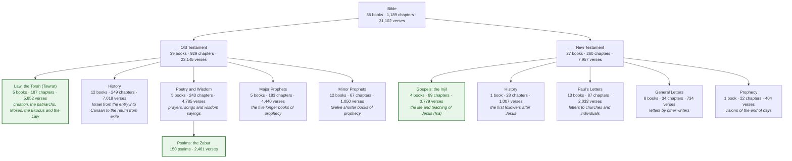
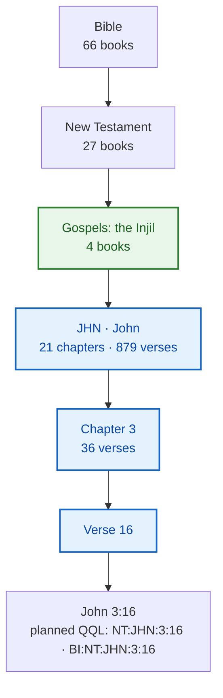
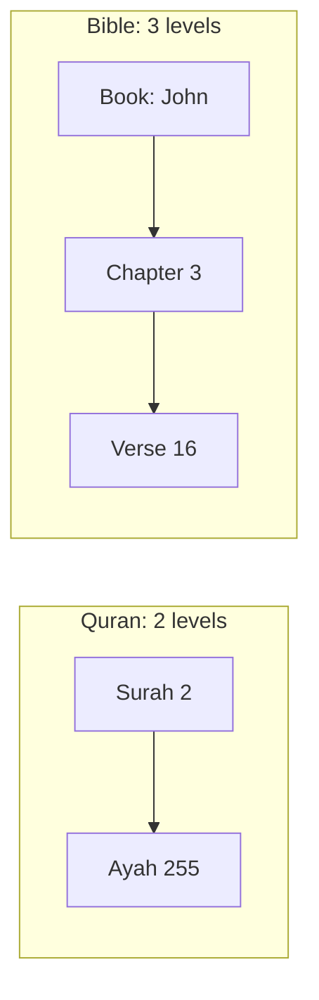
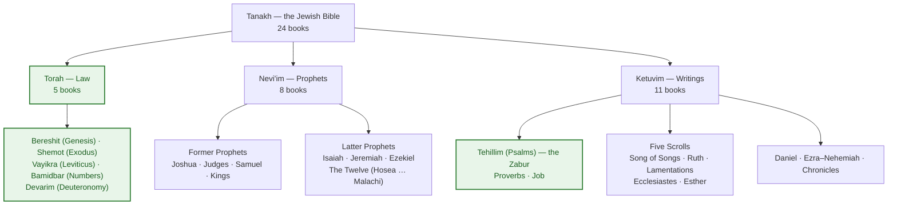

# The structure of the Bible

The Bible is a library rather than a single book: **66 books** in two
collections, the **Old Testament** and the **New Testament**. Within each,
books are grouped by kind — law, history, poetry, prophecy, gospel, letter.

Three of its parts are named in the Quran, and are highlighted in green in
the graphs below:

- the **Torah** (Tawrat), the first five books;
- the **Psalms** (Zabur);
- the **Gospels** (Injil), the first four books of the New Testament.

## At a glance

## Every book

Each book shows its standard code, its English name, its Arabic name in the
Van Dyck Bible, and its number of chapters and verses. The codes are the USFM
abbreviations that the planned QQL syntax uses, as in `OT:GEN:1:1`. The
Torah's books and the Psalms also show their Hebrew names.

### Old Testament

```mermaid
flowchart LR
    OT["Old Testament<br/>39 books · 929 chapters · 23,145 verses"]

    OT --> LAW["Law: the Torah (Tawrat)<br/>5 books · 187 chapters · 5,852 verses"]
    LAW --> B_GEN["GEN · Genesis (Bereshit)<br/>التكوين<br/>50 chapters · 1,533 verses"]
    LAW --> B_EXO["EXO · Exodus (Shemot)<br/>الخروج<br/>40 chapters · 1,213 verses"]
    LAW --> B_LEV["LEV · Leviticus (Vayikra)<br/>اللاويين<br/>27 chapters · 859 verses"]
    LAW --> B_NUM["NUM · Numbers (Bamidbar)<br/>العدد<br/>36 chapters · 1,288 verses"]
    LAW --> B_DEU["DEU · Deuteronomy (Devarim)<br/>التثنية<br/>34 chapters · 959 verses"]

    OT --> OTH["History<br/>12 books · 249 chapters · 7,018 verses"]
    OTH --> B_JOS["JOS · Joshua<br/>يشوع<br/>24 chapters · 658 verses"]
    OTH --> B_JDG["JDG · Judges<br/>القضاة<br/>21 chapters · 618 verses"]
    OTH --> B_RUT["RUT · Ruth<br/>راعوث<br/>4 chapters · 85 verses"]
    OTH --> B_1SA["1SA · 1 Samuel<br/>صموئيل الأول<br/>31 chapters · 810 verses"]
    OTH --> B_2SA["2SA · 2 Samuel<br/>صموئيل الثاني<br/>24 chapters · 695 verses"]
    OTH --> B_1KI["1KI · 1 Kings<br/>الملوك الأول<br/>22 chapters · 816 verses"]
    OTH --> B_2KI["2KI · 2 Kings<br/>الملوك الثاني<br/>25 chapters · 719 verses"]
    OTH --> B_1CH["1CH · 1 Chronicles<br/>١ أخبار<br/>29 chapters · 942 verses"]
    OTH --> B_2CH["2CH · 2 Chronicles<br/>٢ أخبار<br/>36 chapters · 822 verses"]
    OTH --> B_EZR["EZR · Ezra<br/>عزرا<br/>10 chapters · 280 verses"]
    OTH --> B_NEH["NEH · Nehemiah<br/>نحميا<br/>13 chapters · 406 verses"]
    OTH --> B_EST["EST · Esther<br/>أستير<br/>10 chapters · 167 verses"]

    OT --> WIS["Poetry and Wisdom<br/>5 books · 243 chapters · 4,785 verses"]
    WIS --> B_JOB["JOB · Job<br/>أيوب<br/>42 chapters · 1,070 verses"]
    WIS --> B_PSA["PSA · Psalms (Tehillim) — the Zabur<br/>المزامير<br/>150 chapters · 2,461 verses"]
    WIS --> B_PRO["PRO · Proverbs<br/>أمثال<br/>31 chapters · 915 verses"]
    WIS --> B_ECC["ECC · Ecclesiastes<br/>الجامعة<br/>12 chapters · 222 verses"]
    WIS --> B_SNG["SNG · Song of Solomon<br/>نشيد الأنشاد<br/>8 chapters · 117 verses"]

    OT --> MAJ["Major Prophets<br/>5 books · 183 chapters · 4,440 verses"]
    MAJ --> B_ISA["ISA · Isaiah<br/>إشعياء<br/>66 chapters · 1,292 verses"]
    MAJ --> B_JER["JER · Jeremiah<br/>إرميا<br/>52 chapters · 1,364 verses"]
    MAJ --> B_LAM["LAM · Lamentations<br/>مراثي إرميا<br/>5 chapters · 154 verses"]
    MAJ --> B_EZK["EZK · Ezekiel<br/>حزقيال<br/>48 chapters · 1,273 verses"]
    MAJ --> B_DAN["DAN · Daniel<br/>دانيآل<br/>12 chapters · 357 verses"]

    OT --> MIN["Minor Prophets<br/>12 books · 67 chapters · 1,050 verses"]
    MIN --> B_HOS["HOS · Hosea<br/>هوشع<br/>14 chapters · 197 verses"]
    MIN --> B_JOL["JOL · Joel<br/>يوئيل<br/>3 chapters · 73 verses"]
    MIN --> B_AMO["AMO · Amos<br/>عاموس<br/>9 chapters · 146 verses"]
    MIN --> B_OBA["OBA · Obadiah<br/>عوبديا<br/>1 chapters · 21 verses"]
    MIN --> B_JON["JON · Jonah<br/>يونان<br/>4 chapters · 48 verses"]
    MIN --> B_MIC["MIC · Micah<br/>ميخا<br/>7 chapters · 105 verses"]
    MIN --> B_NAM["NAM · Nahum<br/>ناحوم<br/>3 chapters · 47 verses"]
    MIN --> B_HAB["HAB · Habakkuk<br/>حبقوق<br/>3 chapters · 56 verses"]
    MIN --> B_ZEP["ZEP · Zephaniah<br/>صفنيا<br/>3 chapters · 53 verses"]
    MIN --> B_HAG["HAG · Haggai<br/>حجي<br/>2 chapters · 38 verses"]
    MIN --> B_ZEC["ZEC · Zechariah<br/>زكريا<br/>14 chapters · 211 verses"]
    MIN --> B_MAL["MAL · Malachi<br/>ملاخي<br/>4 chapters · 55 verses"]

    classDef islamic fill:#e8f5e9,stroke:#2e7d32,stroke-width:2px,color:#1b5e20;
    class LAW,B_GEN,B_EXO,B_LEV,B_NUM,B_DEU,B_PSA islamic;
```

### New Testament

```mermaid
flowchart LR
    NT["New Testament<br/>27 books · 260 chapters · 7,957 verses"]

    NT --> GOS["Gospels: the Injil<br/>4 books · 89 chapters · 3,779 verses"]
    GOS --> B_MAT["MAT · Matthew<br/>متى<br/>28 chapters · 1,071 verses"]
    GOS --> B_MRK["MRK · Mark<br/>مرقس<br/>16 chapters · 678 verses"]
    GOS --> B_LUK["LUK · Luke<br/>لوقا<br/>24 chapters · 1,151 verses"]
    GOS --> B_JHN["JHN · John<br/>يوحنا<br/>21 chapters · 879 verses"]

    NT --> NTH["History<br/>1 book · 28 chapters · 1,007 verses"]
    NTH --> B_ACT["ACT · Acts<br/>أعمال<br/>28 chapters · 1,007 verses"]

    NT --> PAU["Paul's Letters<br/>13 books · 87 chapters · 2,033 verses"]
    PAU --> B_ROM["ROM · Romans<br/>روما<br/>16 chapters · 433 verses"]
    PAU --> B_1CO["1CO · 1 Corinthians<br/>١ كورنثوس<br/>16 chapters · 437 verses"]
    PAU --> B_2CO["2CO · 2 Corinthians<br/>٢ كورنثوس<br/>13 chapters · 257 verses"]
    PAU --> B_GAL["GAL · Galatians<br/>غلاطية<br/>6 chapters · 149 verses"]
    PAU --> B_EPH["EPH · Ephesians<br/>أفسس<br/>6 chapters · 155 verses"]
    PAU --> B_PHP["PHP · Philippians<br/>فيلبي<br/>4 chapters · 104 verses"]
    PAU --> B_COL["COL · Colossians<br/>كولوسي<br/>4 chapters · 95 verses"]
    PAU --> B_1TH["1TH · 1 Thessalonians<br/>١ تسالونيكي<br/>5 chapters · 89 verses"]
    PAU --> B_2TH["2TH · 2 Thessalonians<br/>٢ تسالونيكي<br/>3 chapters · 47 verses"]
    PAU --> B_1TI["1TI · 1 Timothy<br/>١ تيموثاوس<br/>6 chapters · 113 verses"]
    PAU --> B_2TI["2TI · 2 Timothy<br/>٢ تيموثاوس<br/>4 chapters · 83 verses"]
    PAU --> B_TIT["TIT · Titus<br/>تيطس<br/>3 chapters · 46 verses"]
    PAU --> B_PHM["PHM · Philemon<br/>فليمون<br/>1 chapters · 25 verses"]

    NT --> GEL["General Letters<br/>8 books · 34 chapters · 734 verses"]
    GEL --> B_HEB["HEB · Hebrews<br/>عبرانيين<br/>13 chapters · 303 verses"]
    GEL --> B_JAS["JAS · James<br/>يعقوب<br/>5 chapters · 108 verses"]
    GEL --> B_1PE["1PE · 1 Peter<br/>١ بطرس<br/>5 chapters · 105 verses"]
    GEL --> B_2PE["2PE · 2 Peter<br/>٢ بطرس<br/>3 chapters · 61 verses"]
    GEL --> B_1JN["1JN · 1 John<br/>١ يوحنا<br/>5 chapters · 105 verses"]
    GEL --> B_2JN["2JN · 2 John<br/>٢ يوحنا<br/>1 chapters · 13 verses"]
    GEL --> B_3JN["3JN · 3 John<br/>٣ يوحنا<br/>1 chapters · 14 verses"]
    GEL --> B_JUD["JUD · Jude<br/>يهوذا<br/>1 chapters · 25 verses"]

    NT --> PRP["Prophecy<br/>1 book · 22 chapters · 404 verses"]
    PRP --> B_REV["REV · Revelation<br/>رؤيا<br/>22 chapters · 404 verses"]

    classDef islamic fill:#e8f5e9,stroke:#2e7d32,stroke-width:2px,color:#1b5e20;
    class GOS,B_MAT,B_MRK,B_LUK,B_JHN islamic;
```

Counts are from the King James Version. Other editions number some verses
differently (see the last section below).

## How a verse is addressed

A verse needs three parts — **book, chapter, verse** — where the Quran needs
two (surah, ayah). The testament and the section are groupings: they are
never needed to find a verse, because every book name is unique.

Following **John 3:16** down from the top, with the three parts that address
it in blue:

The same depth against the Quran's:

See [the plan](../bible-plan.md) for how QQL will address the Bible.

## Not every Bible has these 66 books

- **Protestant Bibles** — the KJV, the Van Dyck Arabic and the World English
  Bible — have the 66 books shown above.
- **Catholic Bibles** have 73. The seven extra books (Tobit, Judith, 1 and 2
  Maccabees, Wisdom, Sirach, Baruch) and longer versions of Esther and Daniel
  are all in the Old Testament. **Orthodox** Bibles add a few more.
- **None of them adds anything to the Torah.** The five books are the same in
  every canon. What differs between the Jewish and Christian editions is the
  translation and how some verses are numbered — in ten places in the Torah,
  and across many psalms whose title the Hebrew counts as a verse of its own.
  The details are in [the plan, §2](../bible-plan.md#2-jewish-edition-against-christian-edition).
- Hebrews is grouped with the General Letters here. Some lists put it with
  Paul's, since its author is disputed.

### The Jewish Bible (Tanakh)

The Tanakh has the same contents as the Protestant Old Testament, but counts
them as **24 books** in three parts, in a different order. Samuel, Kings and
Chronicles are one book each, Ezra–Nehemiah is one book, and the twelve minor
prophets are one book, "The Twelve". It has no New Testament.

