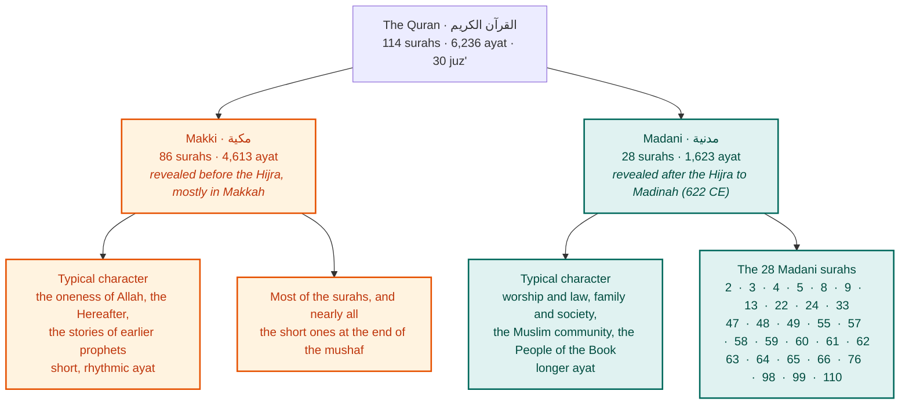
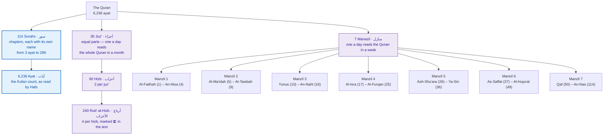
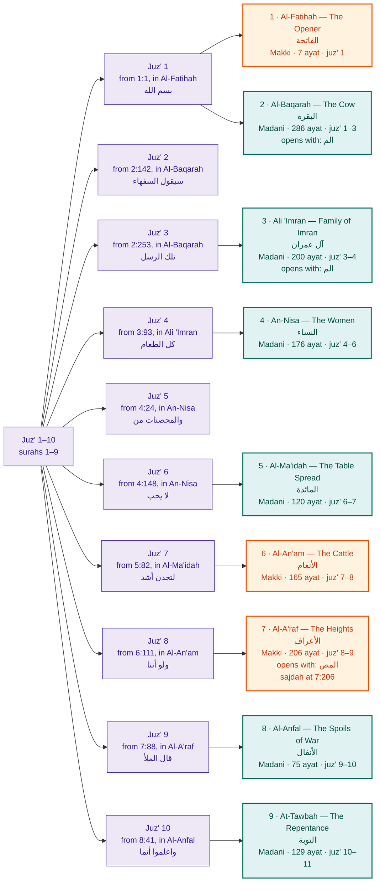
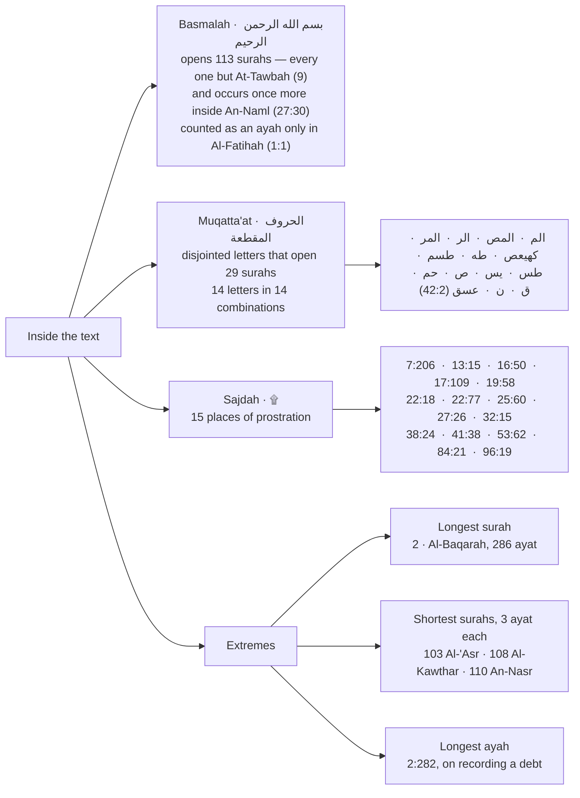
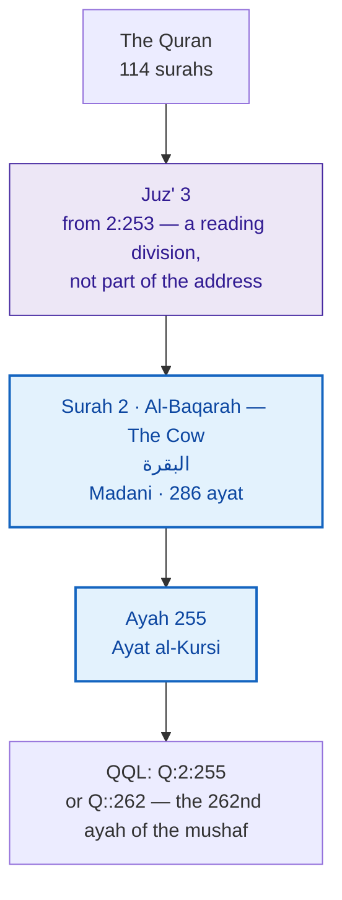

# The structure of the Quran

The Quran is one book of **114 surahs** (chapters), which together hold
**6,236 ayat** (verses). Each surah is classed as **Makki** or
**Madani** by when it was revealed. Alongside that structure, the text is
divided into equal reading portions — juz', hizb and manzil — which help a
reader complete it on a schedule but play no part in addressing an ayah.

Every count below is computed from the Quran data QQL ships, in
`sources/quran/`.

## At a glance

**Makki and Madani are periods, not places.** A Makki surah was revealed
before the Hijra, the migration to Madinah in 622 CE; a Madani surah, after
it, wherever it came down. The classification here is the one carried by the
data, from Tanzil. Scholars differ over a handful of surahs, among them
Ar-Ra'd (13), Ar-Rahman (55), Al-Insan (76) and Az-Zalzalah (99). Some
surahs also contain individual ayat of the other period.

## Divisions

- **Surah and ayah** are the structure of the text itself. They are the only
  two levels an address needs.
- **Juz', hizb and rub'** divide the text into equal portions for reading.
  They cut across surahs: Al-Baqarah spans three juz', while the 30th juz'
  holds 37 whole surahs.
- **Manazil** divide it into seven, for reading the whole Quran in a week.
- **The ayah count** is 6,236 in the Kufan tradition, the one behind Hafs's
  reading and most printed mushafs. The other early traditions divide some
  ayat differently and count a few dozen fewer; the words are the same.

## Every surah

Surahs are grouped under the juz' in which they begin, and coloured by period:
**orange is Makki, green is Madani**. Each shows its number, name and
meaning, its Arabic name, its ayat, and the juz' it covers. Where it applies,
a surah also shows the disjointed letters it opens with and its places of
prostration. Juz' boundaries follow Tanzil's table; some printed mushafs
place a few of them an ayah earlier or later.

### Juz' 1–10

### Juz' 11–20

```mermaid
flowchart LR
    ROOT["Juz' 11–20<br/>surahs 10–29"]

    ROOT --> J11["Juz' 11<br/>from 9:93, in At-Tawbah<br/>إنما السبيل"]
    J11 --> S10["10 · Yunus — Jonah<br/>يونس<br/>Makki · 109 ayat · juz' 11<br/>opens with: الر"]
    J11 --> S11["11 · Hud — Hud<br/>هود<br/>Makki · 123 ayat · juz' 11–12<br/>opens with: الر"]

    ROOT --> J12["Juz' 12<br/>from 11:6, in Hud<br/>وما من"]
    J12 --> S12["12 · Yusuf — Joseph<br/>يوسف<br/>Makki · 111 ayat · juz' 12–13<br/>opens with: الر"]

    ROOT --> J13["Juz' 13<br/>from 12:53, in Yusuf<br/>وما أبرئ"]
    J13 --> S13["13 · Ar-Ra'd — The Thunder<br/>الرعد<br/>Madani · 43 ayat · juz' 13<br/>opens with: المر<br/>sajdah at 13:15"]
    J13 --> S14["14 · Ibrahim — Abraham<br/>ابراهيم<br/>Makki · 52 ayat · juz' 13<br/>opens with: الر"]

    ROOT --> J14["Juz' 14<br/>from 15:1, in Al-Hijr<br/>الر تلك"]
    J14 --> S15["15 · Al-Hijr — The Rocky Tract<br/>الحجر<br/>Makki · 99 ayat · juz' 14<br/>opens with: الر"]
    J14 --> S16["16 · An-Nahl — The Bee<br/>النحل<br/>Makki · 128 ayat · juz' 14<br/>sajdah at 16:50"]

    ROOT --> J15["Juz' 15<br/>from 17:1, in Al-Isra<br/>سبحان الذي"]
    J15 --> S17["17 · Al-Isra — The Night Journey<br/>الإسراء<br/>Makki · 111 ayat · juz' 15<br/>sajdah at 17:109"]
    J15 --> S18["18 · Al-Kahf — The Cave<br/>الكهف<br/>Makki · 110 ayat · juz' 15–16"]

    ROOT --> J16["Juz' 16<br/>from 18:75, in Al-Kahf<br/>قال ألم"]
    J16 --> S19["19 · Maryam — Mary<br/>مريم<br/>Makki · 98 ayat · juz' 16<br/>opens with: كهيعص<br/>sajdah at 19:58"]
    J16 --> S20["20 · Taha — Ta-Ha<br/>طه<br/>Makki · 135 ayat · juz' 16<br/>opens with: طه"]

    ROOT --> J17["Juz' 17<br/>from 21:1, in Al-Anbya<br/>اقترب للناس"]
    J17 --> S21["21 · Al-Anbya — The Prophets<br/>الأنبياء<br/>Makki · 112 ayat · juz' 17"]
    J17 --> S22["22 · Al-Hajj — The Pilgrimage<br/>الحج<br/>Madani · 78 ayat · juz' 17<br/>sajdah at 22:18, 22:77"]

    ROOT --> J18["Juz' 18<br/>from 23:1, in Al-Mu'minun<br/>قد أفلح"]
    J18 --> S23["23 · Al-Mu'minun — The Believers<br/>المؤمنون<br/>Makki · 118 ayat · juz' 18"]
    J18 --> S24["24 · An-Nur — The Light<br/>النور<br/>Madani · 64 ayat · juz' 18"]
    J18 --> S25["25 · Al-Furqan — The Criterion<br/>الفرقان<br/>Makki · 77 ayat · juz' 18–19<br/>sajdah at 25:60"]

    ROOT --> J19["Juz' 19<br/>from 25:21, in Al-Furqan<br/>وقال الذين"]
    J19 --> S26["26 · Ash-Shu'ara — The Poets<br/>الشعراء<br/>Makki · 227 ayat · juz' 19<br/>opens with: طسم"]
    J19 --> S27["27 · An-Naml — The Ant<br/>النمل<br/>Makki · 93 ayat · juz' 19–20<br/>opens with: طس<br/>sajdah at 27:26"]

    ROOT --> J20["Juz' 20<br/>from 27:56, in An-Naml<br/>فما كان"]
    J20 --> S28["28 · Al-Qasas — The Stories<br/>القصص<br/>Makki · 88 ayat · juz' 20<br/>opens with: طسم"]
    J20 --> S29["29 · Al-'Ankabut — The Spider<br/>العنكبوت<br/>Makki · 69 ayat · juz' 20–21<br/>opens with: الم"]

    classDef makki fill:#fff3e0,stroke:#e65100,stroke-width:2px,color:#bf360c;
    classDef madani fill:#e0f2f1,stroke:#00695c,stroke-width:2px,color:#004d40;
    classDef juz fill:#ede7f6,stroke:#4527a0,color:#311b92;
    class ROOT,J11,J12,J13,J14,J15,J16,J17,J18,J19,J20 juz;
    class S10,S11,S12,S14,S15,S16,S17,S18,S19,S20,S21,S23,S25,S26,S27,S28,S29 makki;
    class S13,S22,S24 madani;
```

### Juz' 21–29

```mermaid
flowchart LR
    ROOT["Juz' 21–29<br/>surahs 30–77"]

    ROOT --> J21["Juz' 21<br/>from 29:46, in Al-'Ankabut<br/>ولا تجادلوا"]
    J21 --> S30["30 · Ar-Rum — The Romans<br/>الروم<br/>Makki · 60 ayat · juz' 21<br/>opens with: الم"]
    J21 --> S31["31 · Luqman — Luqman<br/>لقمان<br/>Makki · 34 ayat · juz' 21<br/>opens with: الم"]
    J21 --> S32["32 · As-Sajdah — The Prostration<br/>السجدة<br/>Makki · 30 ayat · juz' 21<br/>opens with: الم<br/>sajdah at 32:15"]
    J21 --> S33["33 · Al-Ahzab — The Combined Forces<br/>الأحزاب<br/>Madani · 73 ayat · juz' 21–22"]

    ROOT --> J22["Juz' 22<br/>from 33:31, in Al-Ahzab<br/>ومن يقنت"]
    J22 --> S34["34 · Saba — Sheba<br/>سبإ<br/>Makki · 54 ayat · juz' 22"]
    J22 --> S35["35 · Fatir — Originator<br/>فاطر<br/>Makki · 45 ayat · juz' 22"]
    J22 --> S36["36 · Ya-Sin — Ya Sin<br/>يس<br/>Makki · 83 ayat · juz' 22–23<br/>opens with: يس"]

    ROOT --> J23["Juz' 23<br/>from 36:28, in Ya-Sin<br/>وما أنزلنا"]
    J23 --> S37["37 · As-Saffat — Those who set the Ranks<br/>الصافات<br/>Makki · 182 ayat · juz' 23"]
    J23 --> S38["38 · Sad — The Letter #quot;Saad#quot;<br/>ص<br/>Makki · 88 ayat · juz' 23<br/>opens with: ص<br/>sajdah at 38:24"]
    J23 --> S39["39 · Az-Zumar — The Troops<br/>الزمر<br/>Makki · 75 ayat · juz' 23–24"]

    ROOT --> J24["Juz' 24<br/>from 39:32, in Az-Zumar<br/>فمن أظلم"]
    J24 --> S40["40 · Ghafir — The Forgiver<br/>غافر<br/>Makki · 85 ayat · juz' 24<br/>opens with: حم"]
    J24 --> S41["41 · Fussilat — Explained in Detail<br/>فصلت<br/>Makki · 54 ayat · juz' 24–25<br/>opens with: حم<br/>sajdah at 41:38"]

    ROOT --> J25["Juz' 25<br/>from 41:47, in Fussilat<br/>إليه يرد"]
    J25 --> S42["42 · Ash-Shuraa — The Consultation<br/>الشورى<br/>Makki · 53 ayat · juz' 25<br/>opens with: حم"]
    J25 --> S43["43 · Az-Zukhruf — The Ornaments of Gold<br/>الزخرف<br/>Makki · 89 ayat · juz' 25<br/>opens with: حم"]
    J25 --> S44["44 · Ad-Dukhan — The Smoke<br/>الدخان<br/>Makki · 59 ayat · juz' 25<br/>opens with: حم"]
    J25 --> S45["45 · Al-Jathiyah — The Crouching<br/>الجاثية<br/>Makki · 37 ayat · juz' 25<br/>opens with: حم"]

    ROOT --> J26["Juz' 26<br/>from 46:1, in Al-Ahqaf<br/>حم"]
    J26 --> S46["46 · Al-Ahqaf — The Wind-Curved Sandhills<br/>الأحقاف<br/>Makki · 35 ayat · juz' 26<br/>opens with: حم"]
    J26 --> S47["47 · Muhammad — Muhammad<br/>محمد<br/>Madani · 38 ayat · juz' 26"]
    J26 --> S48["48 · Al-Fath — The Victory<br/>الفتح<br/>Madani · 29 ayat · juz' 26"]
    J26 --> S49["49 · Al-Hujurat — The Rooms<br/>الحجرات<br/>Madani · 18 ayat · juz' 26"]
    J26 --> S50["50 · Qaf — The Letter #quot;Qaf#quot;<br/>ق<br/>Makki · 45 ayat · juz' 26<br/>opens with: ق"]
    J26 --> S51["51 · Adh-Dhariyat — The Winnowing Winds<br/>الذاريات<br/>Makki · 60 ayat · juz' 26–27"]

    ROOT --> J27["Juz' 27<br/>from 51:31, in Adh-Dhariyat<br/>قال فما"]
    J27 --> S52["52 · At-Tur — The Mount<br/>الطور<br/>Makki · 49 ayat · juz' 27"]
    J27 --> S53["53 · An-Najm — The Star<br/>النجم<br/>Makki · 62 ayat · juz' 27<br/>sajdah at 53:62"]
    J27 --> S54["54 · Al-Qamar — The Moon<br/>القمر<br/>Makki · 55 ayat · juz' 27"]
    J27 --> S55["55 · Ar-Rahman — The Beneficent<br/>الرحمن<br/>Madani · 78 ayat · juz' 27"]
    J27 --> S56["56 · Al-Waqi'ah — The Inevitable<br/>الواقعة<br/>Makki · 96 ayat · juz' 27"]
    J27 --> S57["57 · Al-Hadid — The Iron<br/>الحديد<br/>Madani · 29 ayat · juz' 27"]

    ROOT --> J28["Juz' 28<br/>from 58:1, in Al-Mujadila<br/>قد سمع"]
    J28 --> S58["58 · Al-Mujadila — The Pleading Woman<br/>المجادلة<br/>Madani · 22 ayat · juz' 28"]
    J28 --> S59["59 · Al-Hashr — The Exile<br/>الحشر<br/>Madani · 24 ayat · juz' 28"]
    J28 --> S60["60 · Al-Mumtahanah — She that is to be examined<br/>الممتحنة<br/>Madani · 13 ayat · juz' 28"]
    J28 --> S61["61 · As-Saf — The Ranks<br/>الصف<br/>Madani · 14 ayat · juz' 28"]
    J28 --> S62["62 · Al-Jumu'ah — The Congregation, Friday<br/>الجمعة<br/>Madani · 11 ayat · juz' 28"]
    J28 --> S63["63 · Al-Munafiqun — The Hypocrites<br/>المنافقون<br/>Madani · 11 ayat · juz' 28"]
    J28 --> S64["64 · At-Taghabun — The Mutual Disillusion<br/>التغابن<br/>Madani · 18 ayat · juz' 28"]
    J28 --> S65["65 · At-Talaq — The Divorce<br/>الطلاق<br/>Madani · 12 ayat · juz' 28"]
    J28 --> S66["66 · At-Tahrim — The Prohibition<br/>التحريم<br/>Madani · 12 ayat · juz' 28"]

    ROOT --> J29["Juz' 29<br/>from 67:1, in Al-Mulk<br/>تبارك الذي"]
    J29 --> S67["67 · Al-Mulk — The Sovereignty<br/>الملك<br/>Makki · 30 ayat · juz' 29"]
    J29 --> S68["68 · Al-Qalam — The Pen<br/>القلم<br/>Makki · 52 ayat · juz' 29<br/>opens with: ن"]
    J29 --> S69["69 · Al-Haqqah — The Reality<br/>الحاقة<br/>Makki · 52 ayat · juz' 29"]
    J29 --> S70["70 · Al-Ma'arij — The Ascending Stairways<br/>المعارج<br/>Makki · 44 ayat · juz' 29"]
    J29 --> S71["71 · Nuh — Noah<br/>نوح<br/>Makki · 28 ayat · juz' 29"]
    J29 --> S72["72 · Al-Jinn — The Jinn<br/>الجن<br/>Makki · 28 ayat · juz' 29"]
    J29 --> S73["73 · Al-Muzzammil — The Enshrouded One<br/>المزمل<br/>Makki · 20 ayat · juz' 29"]
    J29 --> S74["74 · Al-Muddaththir — The Cloaked One<br/>المدثر<br/>Makki · 56 ayat · juz' 29"]
    J29 --> S75["75 · Al-Qiyamah — The Resurrection<br/>القيامة<br/>Makki · 40 ayat · juz' 29"]
    J29 --> S76["76 · Al-Insan — The Man<br/>الانسان<br/>Madani · 31 ayat · juz' 29"]
    J29 --> S77["77 · Al-Mursalat — The Emissaries<br/>المرسلات<br/>Makki · 50 ayat · juz' 29"]

    classDef makki fill:#fff3e0,stroke:#e65100,stroke-width:2px,color:#bf360c;
    classDef madani fill:#e0f2f1,stroke:#00695c,stroke-width:2px,color:#004d40;
    classDef juz fill:#ede7f6,stroke:#4527a0,color:#311b92;
    class ROOT,J21,J22,J23,J24,J25,J26,J27,J28,J29 juz;
    class S30,S31,S32,S34,S35,S36,S37,S38,S39,S40,S41,S42,S43,S44,S45,S46,S50,S51,S52,S53,S54,S56,S67,S68,S69,S70,S71,S72,S73,S74,S75,S77 makki;
    class S33,S47,S48,S49,S55,S57,S58,S59,S60,S61,S62,S63,S64,S65,S66,S76 madani;
```

### Juz' 30

```mermaid
flowchart LR
    ROOT["Juz' 30<br/>surahs 78–114"]

    ROOT --> J30["Juz' 30<br/>from 78:1, in An-Naba<br/>عم يتساءلون"]
    J30 --> S78["78 · An-Naba — The Tidings<br/>النبإ<br/>Makki · 40 ayat · juz' 30"]
    J30 --> S79["79 · An-Nazi'at — Those who drag forth<br/>النازعات<br/>Makki · 46 ayat · juz' 30"]
    J30 --> S80["80 · 'Abasa — He Frowned<br/>عبس<br/>Makki · 42 ayat · juz' 30"]
    J30 --> S81["81 · At-Takwir — The Overthrowing<br/>التكوير<br/>Makki · 29 ayat · juz' 30"]
    J30 --> S82["82 · Al-Infitar — The Cleaving<br/>الإنفطار<br/>Makki · 19 ayat · juz' 30"]
    J30 --> S83["83 · Al-Mutaffifin — The Defrauding<br/>المطففين<br/>Makki · 36 ayat · juz' 30"]
    J30 --> S84["84 · Al-Inshiqaq — The Sundering<br/>الإنشقاق<br/>Makki · 25 ayat · juz' 30<br/>sajdah at 84:21"]
    J30 --> S85["85 · Al-Buruj — The Mansions of the Stars<br/>البروج<br/>Makki · 22 ayat · juz' 30"]
    J30 --> S86["86 · At-Tariq — The Nightcommer<br/>الطارق<br/>Makki · 17 ayat · juz' 30"]
    J30 --> S87["87 · Al-A'la — The Most High<br/>الأعلى<br/>Makki · 19 ayat · juz' 30"]
    J30 --> S88["88 · Al-Ghashiyah — The Overwhelming<br/>الغاشية<br/>Makki · 26 ayat · juz' 30"]
    J30 --> S89["89 · Al-Fajr — The Dawn<br/>الفجر<br/>Makki · 30 ayat · juz' 30"]
    J30 --> S90["90 · Al-Balad — The City<br/>البلد<br/>Makki · 20 ayat · juz' 30"]
    J30 --> S91["91 · Ash-Shams — The Sun<br/>الشمس<br/>Makki · 15 ayat · juz' 30"]
    J30 --> S92["92 · Al-Layl — The Night<br/>الليل<br/>Makki · 21 ayat · juz' 30"]
    J30 --> S93["93 · Ad-Duhaa — The Morning Hours<br/>الضحى<br/>Makki · 11 ayat · juz' 30"]
    J30 --> S94["94 · Ash-Sharh — The Relief<br/>الشرح<br/>Makki · 8 ayat · juz' 30"]
    J30 --> S95["95 · At-Tin — The Fig<br/>التين<br/>Makki · 8 ayat · juz' 30"]
    J30 --> S96["96 · Al-'Alaq — The Clot<br/>العلق<br/>Makki · 19 ayat · juz' 30<br/>sajdah at 96:19"]
    J30 --> S97["97 · Al-Qadr — The Power<br/>القدر<br/>Makki · 5 ayat · juz' 30"]
    J30 --> S98["98 · Al-Bayyinah — The Clear Proof<br/>البينة<br/>Madani · 8 ayat · juz' 30"]
    J30 --> S99["99 · Az-Zalzalah — The Earthquake<br/>الزلزلة<br/>Madani · 8 ayat · juz' 30"]
    J30 --> S100["100 · Al-'Adiyat — The Courser<br/>العاديات<br/>Makki · 11 ayat · juz' 30"]
    J30 --> S101["101 · Al-Qari'ah — The Calamity<br/>القارعة<br/>Makki · 11 ayat · juz' 30"]
    J30 --> S102["102 · At-Takathur — The Rivalry in world increase<br/>التكاثر<br/>Makki · 8 ayat · juz' 30"]
    J30 --> S103["103 · Al-'Asr — The Declining Day<br/>العصر<br/>Makki · 3 ayat · juz' 30"]
    J30 --> S104["104 · Al-Humazah — The Traducer<br/>الهمزة<br/>Makki · 9 ayat · juz' 30"]
    J30 --> S105["105 · Al-Fil — The Elephant<br/>الفيل<br/>Makki · 5 ayat · juz' 30"]
    J30 --> S106["106 · Quraysh — Quraysh<br/>قريش<br/>Makki · 4 ayat · juz' 30"]
    J30 --> S107["107 · Al-Ma'un — The Small kindnesses<br/>الماعون<br/>Makki · 7 ayat · juz' 30"]
    J30 --> S108["108 · Al-Kawthar — The Abundance<br/>الكوثر<br/>Makki · 3 ayat · juz' 30"]
    J30 --> S109["109 · Al-Kafirun — The Disbelievers<br/>الكافرون<br/>Makki · 6 ayat · juz' 30"]
    J30 --> S110["110 · An-Nasr — The Divine Support<br/>النصر<br/>Madani · 3 ayat · juz' 30"]
    J30 --> S111["111 · Al-Masad — The Palm Fiber<br/>المسد<br/>Makki · 5 ayat · juz' 30"]
    J30 --> S112["112 · Al-Ikhlas — The Sincerity<br/>الإخلاص<br/>Makki · 4 ayat · juz' 30"]
    J30 --> S113["113 · Al-Falaq — The Daybreak<br/>الفلق<br/>Makki · 5 ayat · juz' 30"]
    J30 --> S114["114 · An-Nas — Mankind<br/>الناس<br/>Makki · 6 ayat · juz' 30"]

    classDef makki fill:#fff3e0,stroke:#e65100,stroke-width:2px,color:#bf360c;
    classDef madani fill:#e0f2f1,stroke:#00695c,stroke-width:2px,color:#004d40;
    classDef juz fill:#ede7f6,stroke:#4527a0,color:#311b92;
    class ROOT,J30 juz;
    class S78,S79,S80,S81,S82,S83,S84,S85,S86,S87,S88,S89,S90,S91,S92,S93,S94,S95,S96,S97,S100,S101,S102,S103,S104,S105,S106,S107,S108,S109,S111,S112,S113,S114 makki;
    class S98,S99,S110 madani;
```

## Inside the text

The schools of law differ over whether all fifteen places of prostration
require it. The text marks all fifteen with ۩, and QQL carries the mark as
part of the ayah.

## How an ayah is addressed

An ayah needs two parts: **surah and ayah**. Ayat al-Kursi is Surah 2,
Ayah 255. The juz' it falls in is useful for reading, but no part of the
address.

In QQL the source code is optional and defaults to the Quran, so `2:255` is
the same reference as `Q:2:255`. `Q:2` is the whole surah, and `Q::N`
counts ayat from the start of the mushaf. See the
[README](../../README.md#numbering).

## Order of the mushaf and order of revelation

The surahs are not arranged in the order they were revealed. The mushaf
opens with Al-Fatihah and then runs, broadly, from the longest surahs to the
shortest. The first ayat revealed were the opening of Al-'Alaq (96:1–5), near
the end of the mushaf. This is why most Makki surahs, the earlier
revelations, sit toward the end.

See also [the structure of the Bible](bible.md).
